# Glad

[](https://github.com/Aohzan/glad/actions/workflows/ci.yml) [](https://github.com/Aohzan/glad/actions/workflows/docker-publish.yml)  [](LICENSE.md)

:uk: Glad is a web app to follow its investments and properties, principally based on financial and properties in France (glad come from Breton).

:fr: Glad est une application web pour suivre ses investissements et propriétés, principalement basés sur les finances et propriétés en France (glad vient du breton).

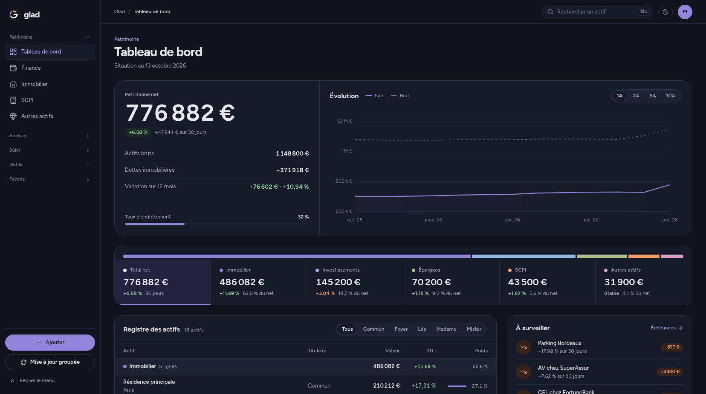

## Features

### Finance

- **Savings accounts** — track values, interest rates, deposits, and historical progression
- **Investment accounts** — manage cash and security holdings with price history and valuation charts
- Portfolio dashboard with gain/loss tracking across all accounts
- Batch update to easily update prices and valuations for multiple accounts at once
- CSV import/export for bulk data entry
- **French envelopes** — deposit ceilings (Livret A, LDDS, LEP, PEL, PEA…), tax milestones (PEA 5 years, life insurance 8 years, PEL 10/15 years) and liquidity of each account type
- Savings book interest estimated with the fortnight rule (règle des quinzaines)
- Annualized money-weighted return (XIRR), real return deflated with the INSEE consumer price index, and comparison with a benchmark index fund
- Life insurance split between euro funds and units of account, with the yearly credited rates
- **Other assets** — vehicles, precious metals, crypto-assets, unlisted shares, collectibles, optionally valued from a market symbol
- **Daily prices** — the market close of every held security is stored each day; the holdings you choose are valued automatically from it

### Properties

- **Property management** — purchase price, fees (notary, agency, credit), valuation history, co-ownership share
- **Loans** — multiple loans per property, each with one amortization schedule that every figure and chart reads: computed from the loan parameters (French amortization, broken first period handled as banks do) or imported from the bank's table as CSV, which also covers smoothed loans (prêt lisseur); repaid with the sale of the property
- **Leases & tenants** — furnished/empty/commercial leases, rent, charges, security deposit, recurring entries
- **Ledger** — categorized income and expense entries (rent, management fees, works, insurance, property tax, etc.) with recurring support and CSV import
- **Management mandates** — track property managers with fee structures
- **Financial reporting** — monthly balance sheets, accounting dashboard, income/expense summaries with deductible breakdown
- **LMNP** (*beta*) — accounting support: cerfa 2033/2031/2042-C PRO computed from the ledger, frozen yearly declarations and PDF export (see [docs/lmnp.md](docs/lmnp.md))
- **SCPI** — track SCPI shares with valuation and dividend history
- **Rent revision** — yearly IRL revision of the leases from the INSEE index, applied to the lease and its recurring rent entries
- **DPE** — energy rating with the rental bans (G 2025, F 2028, E 2034), the rent freeze of F/G housing and the diagnosis validity
- **Resale simulation** — capital gain tax with allowances, surtax and the add-back of the LMNP amortization (finance act 2025)

### Rental management

For the leases you manage yourself, without an agency (see [docs/rental.md](docs/rental.md)):

- **Applications** — candidates with their documents, the allowed and forbidden ones (décret 2015-1437), the effort rate, and the lease created from the accepted one
- **Move-in** — lease PDF following the standard contract (décret 2015-587), interactive inventory of fixtures room by room with photos taken from the phone, electronic signature with a self-hosted [Documenso](https://documenso.com), deposit received
- **Checklist** — signed lease and inventory, deposit cap, guarantee, tenant insurance, DPE and the diagnostics required by the construction year
- **Rent** — rent schedule, payments checked month after month, late rents, receipts (quittance or partial receipt) in PDF, rent notices, reminders, formal notice and rent revision letter, each email checked before it is sent or sent automatically
- **Charges** — recoverable expenses of the ledger, yearly reconciliation with the provisions, statement in PDF and new provision
- **Departure** — notice with the legal end date, exit inventory compared with the entry one, deposit return with deductions, deadline and late penalty, closing of the lease
- Dashboard with the rents received this month, the unpaid ones, the occupancy, the points to check and the rental deadlines

### Household budget

- **Yearly budget** — income per person or for the whole household, expenses and savings in a shared category tree (up to three levels), entered as yearly amounts
- Rents, charges and loan installments of the properties, SCPI dividends and subscriptions, and account deposits added automatically for the year
- Sankey diagram of where the money goes, for the whole household or one member (shared lines split between the adults)
- Savings rate, HCSF debt ratio and money left to live, comparison with the previous year (in real terms with the INSEE CPI), copy of a year with a revaluation
- CSV import and export, with a prompt to build the file from a bank export with an AI (see [docs/budget.md](docs/budget.md))

### Net worth

- Dashboard with the upcoming deadlines of every asset and a monthly net worth history stored as snapshots
- Allocation by asset class and by liquidity, and emergency fund sized in months of expenses (from the budget when there is one)
- Owners among the application users, with shares and dismembered rights valued with article 669 CGI, and the net worth of each owner

### Notifications

- Alerts on the application bell and on any channel: email or one of the 100+ services of [Apprise](https://appriseit.com/services/) (ntfy, Gotify, Telegram, Discord…), see [docs/notifications.md](docs/notifications.md)
- Each alert enabled and tuned per user: security or account drop, data to update, income tax and LMNP returns, local taxes, deadlines of the leases, loans and DPE, late rent, tenant insurance, deposit return, signatures, new release, login…

### AI assistants

- [MCP](https://modelcontextprotocol.io) server for Claude Code, Claude Desktop, Cursor…: net worth, accounts, properties, leases, budget and LMNP analyses, pending checks, and entry of values, expenses, received rents and budget lines, see [docs/mcp.md](docs/mcp.md)
- Read-only or read-write API keys per user, with the log of every call

### Web application

- Multi-language support (English and French)
- Multi-currency support
- Dark mode
- Responsive design
- Passwordless authentication with passkeys (WebAuthn)

## Screenshots

| | | |
|---|---|---|
| [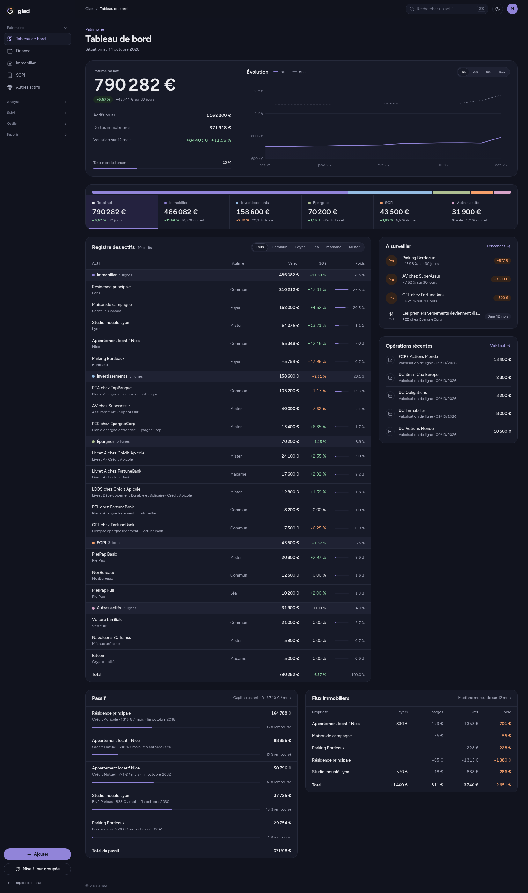](docs/images/dashboard.png) | [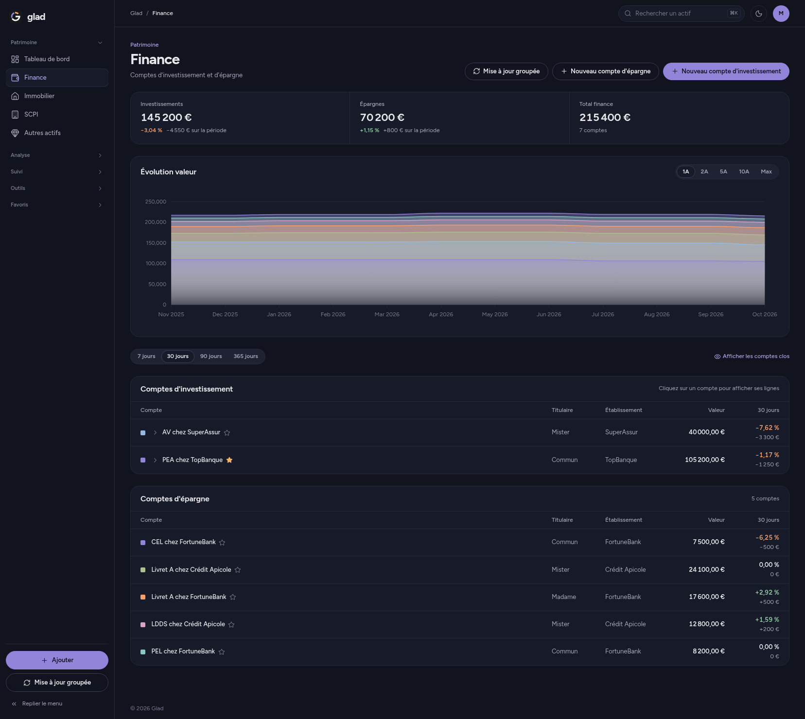](docs/images/finance_home.png) | [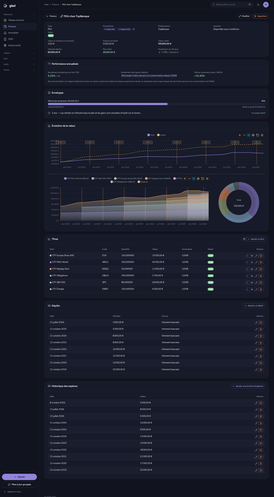](docs/images/finance_invest.png) |
| Dashboard | Finance home | Finance investments |
| [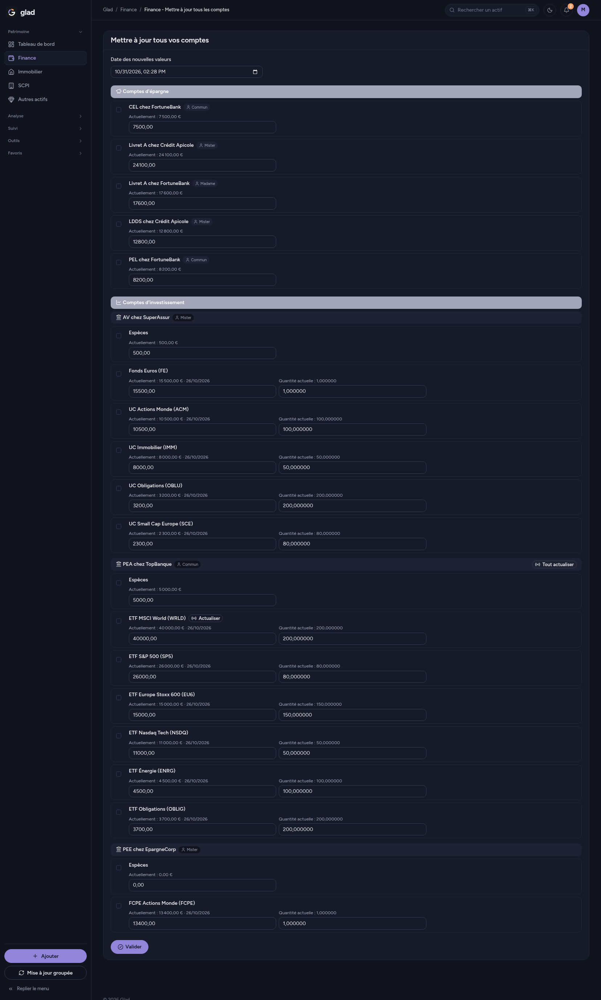](docs/images/finance_batch_update.png) | [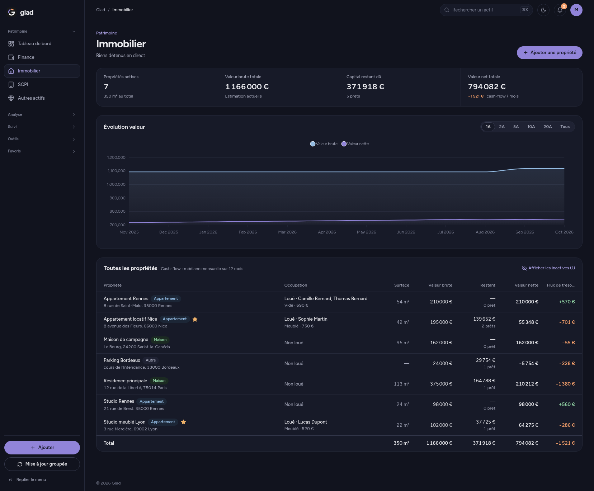](docs/images/property_home.png) | [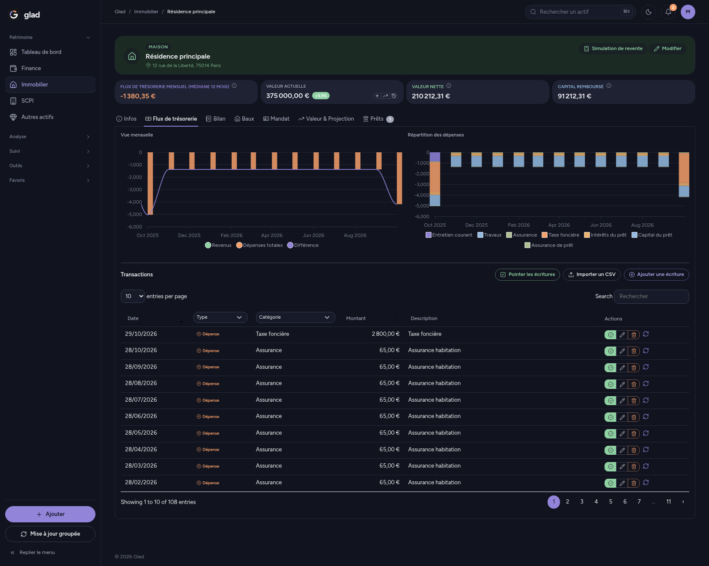](docs/images/property_details.png) |
| Finance batch update | Property home | Property details |
| [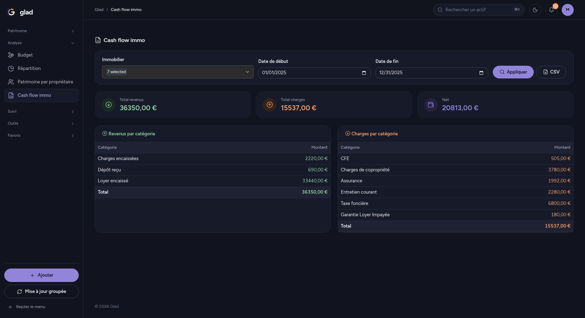](docs/images/property_accounting.png) | [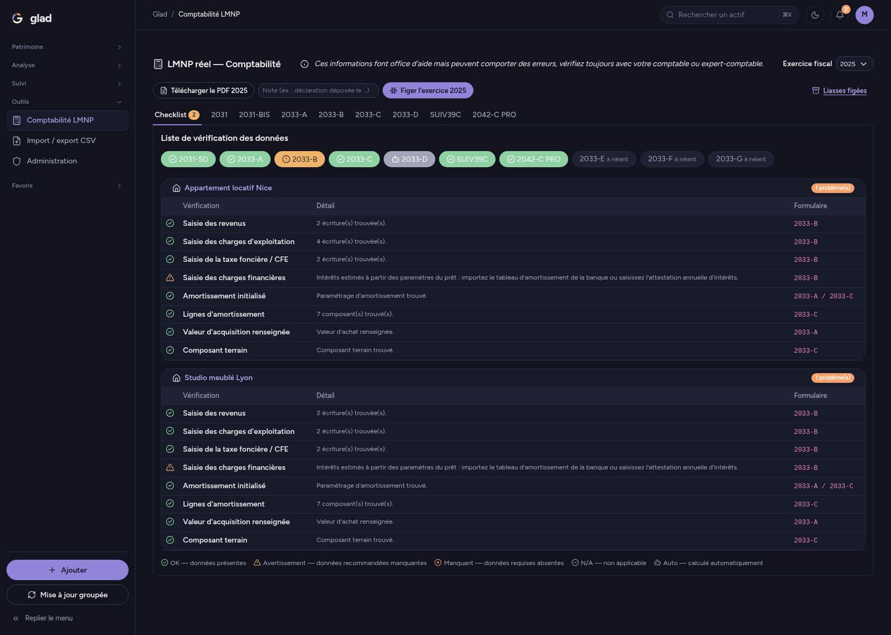](docs/images/property_lmnp.png) | [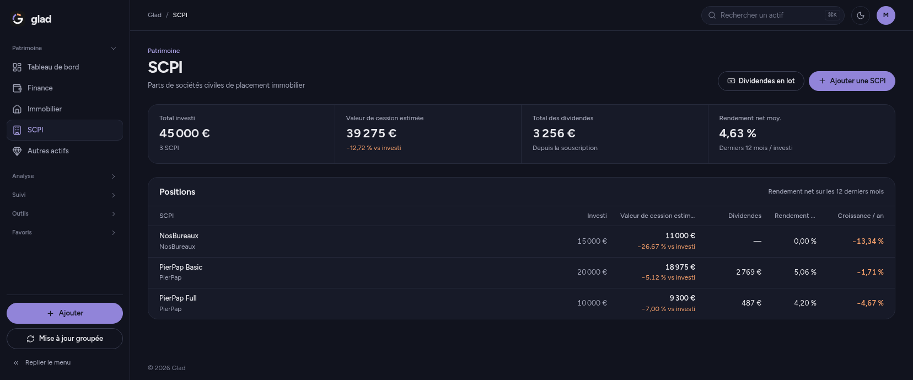](docs/images/scpi.png) |
| Property cash flow | Property LMNP | SCPI |
| [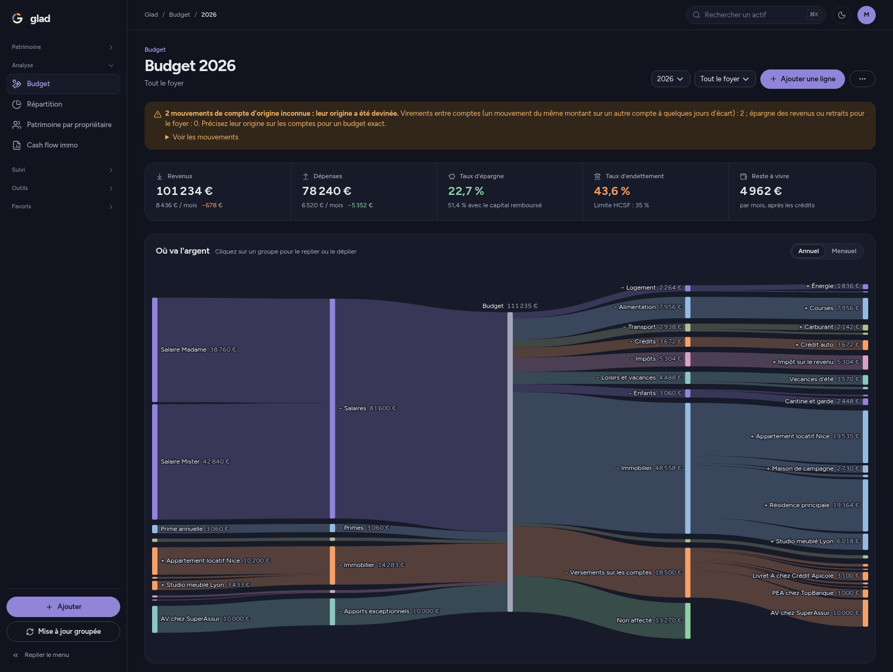](docs/images/budget.png) | [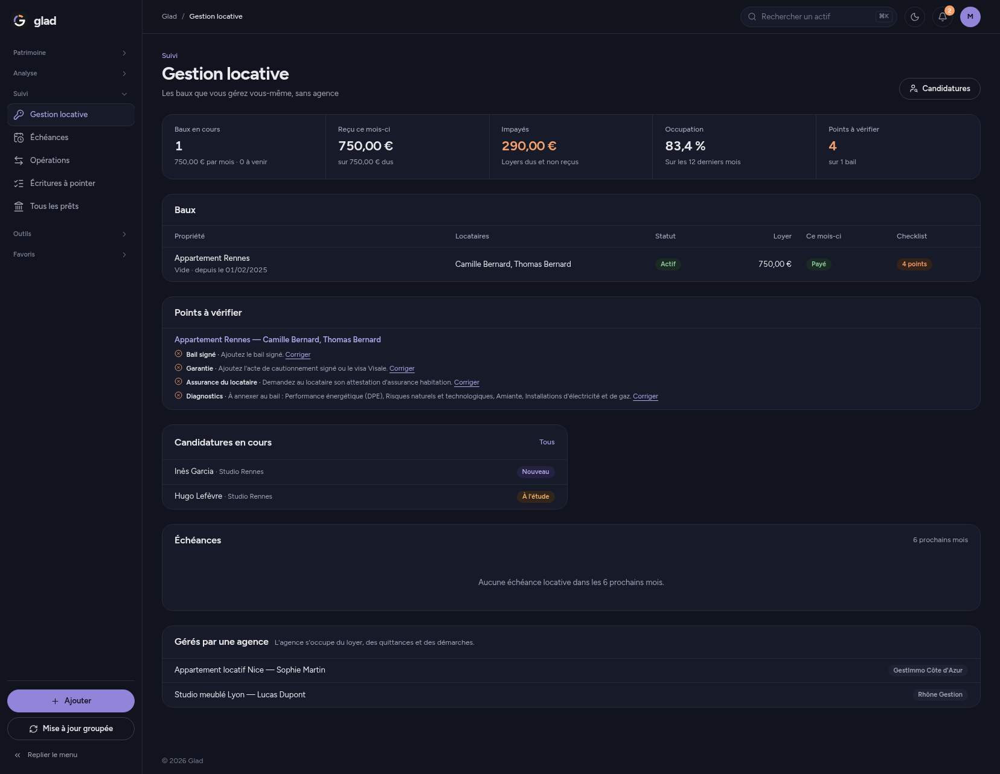](docs/images/rental_dashboard.png) | [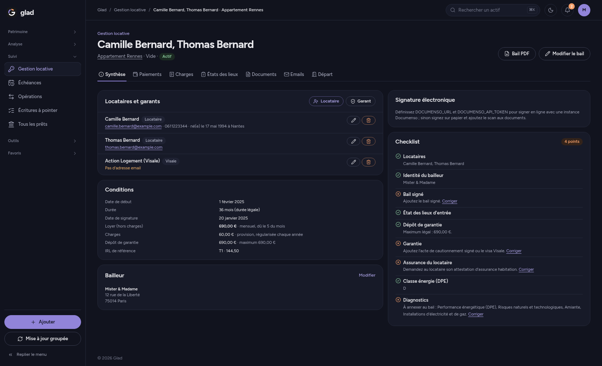](docs/images/rental_lease.png) |
| Household budget | Rental management | Lease |
| [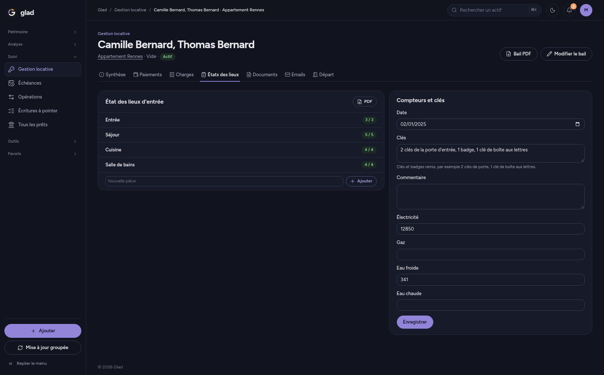](docs/images/rental_inventory.png) | [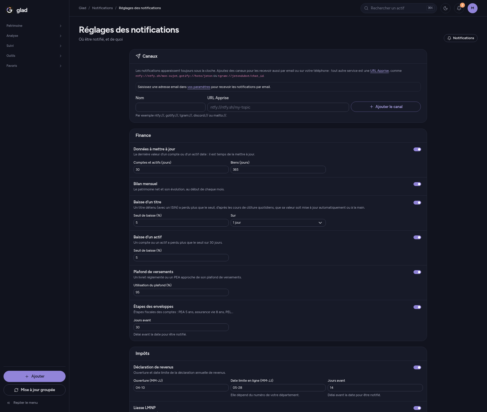](docs/images/notifications_settings.png) | [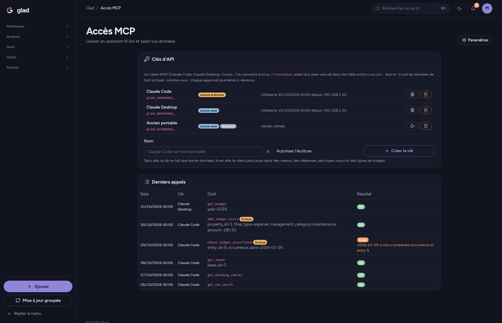](docs/images/mcp_settings.png) |
| Inventory of fixtures | Notification settings | MCP access |

## Configuration

### Docker Compose

```yaml
services:
  glad:
    image: ghcr.io/aohzan/glad:latest
    container_name: glad
    restart: unless-stopped
    ports:
      - 8000:8000
    volumes:
      - /opt/glad:/app/data
    environment:
      SECRET_KEY: "change-me-to-a-long-random-string"
      APP_URL: "https://glad.my.domain"
```

The `/app/data` volume holds the SQLite database and the uploaded documents (`media/`: leases, inventories, photos, receipts). Next to the web server, the container runs a worker for the background tasks (emails, notifications) and a scheduler for the daily jobs (prices, notification checks, rent emails); set `BACKGROUND_JOBS_ENABLED=false` to run them elsewhere.

The image runs the application as an unprivileged user (`glad`, UID 1000). On start it takes ownership of `/app/data` if needed, so volumes created by older versions keep working. The container exposes port 8000, answers health checks on `/health`, and the `latest` tag always points to the latest release. Images are published for `linux/amd64` and `linux/arm64`.

Generate a secret key with:

```shell
python -c "from django.core.management.utils import get_random_secret_key; print(get_random_secret_key())"
```

### Environment variables

When `APP_URL` uses `https`, the secure defaults below (SSL redirect, secure cookies, HSTS, proxy SSL header) are enabled automatically.

| Variable                | Required    | Default                 | Description                                                                      |
| ----------------------- | ----------- | ----------------------- | -------------------------------------------------------------------------------- |
| `SECRET_KEY`            | Yes         | —                       | Django secret key — the app refuses to start without it                          |
| `APP_URL`               | Yes         | —                       | Canonical public URL (e.g. `https://glad.my.domain`)                             |
| `ALLOWED_HOSTS`         | No          | hostname of `APP_URL`   | Comma-separated list of allowed hostnames                                        |
| `CSRF_TRUSTED_ORIGINS`  | No          | `APP_URL`               | Comma-separated list of trusted origins for CSRF                                 |
| `SECURE_SSL_REDIRECT`   | No          | `true` if `APP_URL` is https | Redirect plain HTTP requests to HTTPS (`/health` is exempt)                 |
| `SESSION_COOKIE_SECURE` | No          | `true` if `APP_URL` is https | Send the session cookie over HTTPS only                                     |
| `CSRF_COOKIE_SECURE`    | No          | `true` if `APP_URL` is https | Send the CSRF cookie over HTTPS only                                        |
| `SESSION_COOKIE_AGE`    | No          | `28800` (8 hours)       | Session lifetime in seconds, reset on every request                              |
| `DEFAULT_LANGUAGE`      | No          | `fr`                    | Default UI language (`fr` or `en`)                                               |
| `WEBAUTHN_ORIGIN`       | No          | `APP_URL`               | Override the WebAuthn origin (passkey authentication)                            |
| `WEBAUTHN_RP_ID`        | No          | hostname of `APP_URL`   | Override the WebAuthn relying party ID                                           |
| `SUB_PATH`              | No          | —                       | URL sub-path prefix if the app is served under a sub-path (e.g. `/glad`)         |
| `UVICORN_OPTIONS`       | No          | —                       | Extra options for the ASGI server (e.g. `--proxy-headers --forwarded-allow-ips='*'`) |
| `ENVIRONMENT`           | No          | `production`            | `development` or `production`, used for warnings only                            |
| `DEBUG`                 | No          | `false`                 | Set to `true` for development only                                               |
| `DB`                    | No          | SQLite                  | Set to `postgres` to use PostgreSQL                                              |
| `DB_NAME`               | No          | —                       | PostgreSQL database name                                                         |
| `DB_USER`               | No          | —                       | PostgreSQL user                                                                  |
| `DB_PASSWORD`           | No          | —                       | PostgreSQL password                                                              |
| `DB_HOST`               | No          | —                       | PostgreSQL host                                                                  |
| `DB_PORT`               | No          | `5432`                  | PostgreSQL port                                                                  |
| `DB_SSL_MODE`           | No          | `prefer`                | PostgreSQL `sslmode` (`disable`, `prefer`, `require`, `verify-full`, ...)        |
| `DB_CONN_MAX_AGE`       | No          | `600`                   | PostgreSQL persistent connection lifetime in seconds (`0` to disable)            |
| `EMAIL_HOST`            | No          | —                       | SMTP host; when empty, emails are printed to the console                         |
| `EMAIL_PORT`            | No          | `587`                   | SMTP port (`465` enables SSL, `587` enables TLS by default)                      |
| `EMAIL_HOST_USER`       | No          | —                       | SMTP user                                                                        |
| `EMAIL_HOST_PASSWORD`   | No          | —                       | SMTP password                                                                    |
| `EMAIL_USE_TLS`         | No          | derived from port       | Force STARTTLS on or off                                                         |
| `EMAIL_USE_SSL`         | No          | derived from port       | Force implicit SSL on or off                                                     |
| `EMAIL_TIMEOUT`         | No          | `10`                    | SMTP timeout in seconds                                                          |
| `DEFAULT_FROM_EMAIL`    | No          | `Glad <glad@localhost>` | Sender address for notifications                                                 |
| `EMAIL_SUBJECT_PREFIX`  | No          | `[Glad] `               | Prefix of email subjects                                                         |
| `BACKGROUND_JOBS_ENABLED` | No        | `true`                  | Start the task worker and the scheduler with the web server                      |
| `TASKS_BACKEND`         | No          | database                | `immediate` runs the background tasks inline (development, no worker needed)     |
| `NOTIFICATIONS_TIME`    | No          | `08:00`                 | Time of the daily notification checks (HH:MM, server time zone)                  |
| `MEDIA_ROOT`            | No          | `data/media`            | Folder of the uploaded documents                                                 |
| `DOCUMENSO_URL`         | No          | —                       | URL of a Documenso instance, to sign the leases and inventories online           |
| `DOCUMENSO_API_TOKEN`   | No          | —                       | API token of the Documenso instance                                              |

### Database

Glad uses SQLite by default. PostgreSQL is also supported — see [Database Configuration](docs/database.md) for details.

## Development

```shell
uv sync --dev          # Python dependencies
npm ci                 # front-end vendors into static/vendors/
uv run pre-commit install
ENV_FILE=.env.dev uv run manage.py migrate
ENV_FILE=.env.dev uv run manage.py runserver
ENV_FILE=.env.dev uv run pytest --cov
```

Releases are cut automatically by [python-semantic-release](https://python-semantic-release.readthedocs.io/) from [conventional commits](https://www.conventionalcommits.org/) pushed to `main` (`beta` produces pre-releases). Each release publishes a GitHub release, a changelog entry and a Docker image.

## Security

See [SECURITY.md](SECURITY.md) to report a vulnerability.

## License

This project is licensed under the GNU GPLv3 License - see the LICENSE file for details.
